<picture>
  <source media="(prefers-reduced-motion: reduce)" srcset="assets/cyberpunk/identidad.png">
  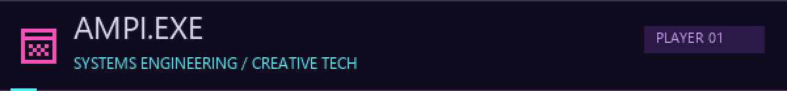
</picture>

# AMPI.EXE · Ideas con propósito

**Estudiante de Ingeniería de Sistemas e Informática. Desarrollo, diseño, innovación y proyectos que conectan tecnología con necesidades reales.**

[INIT SYSTEM](#player-profile) · [EXPLORE PROJECTS](#mission-select) · [VIEW ACTIVITY](#contribution-map) · [SKILL TREE](#skill-tree)

<a href="#player-profile"><picture><source media="(prefers-reduced-motion: reduce)" srcset="assets/cyberpunk/nav-profile.png">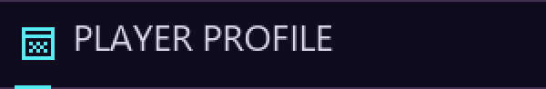</picture></a> <a href="#mission-select"><picture><source media="(prefers-reduced-motion: reduce)" srcset="assets/cyberpunk/nav-missions.png">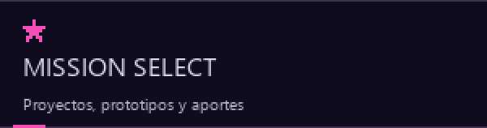</picture></a>

<a href="#contribution-map"><picture><source media="(prefers-reduced-motion: reduce)" srcset="assets/cyberpunk/nav-activity.png">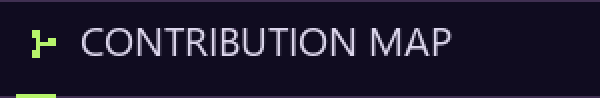</picture></a> <a href="#skill-tree"><picture><source media="(prefers-reduced-motion: reduce)" srcset="assets/cyberpunk/nav-skills.png">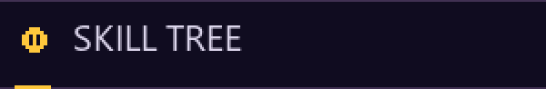</picture></a>

## Player profile

Me gusta entender una necesidad, darle forma a una idea y colaborar para construir una solución. Mi recorrido combina **desarrollo de software, diseño de interfaces, análisis de procesos y organización de proyectos**. Me interesan la comunicación en equipo, las metodologías y la innovación con impacto social.

Impulsé **EduKids**, que evolucionó hacia **ASHAKids** desde una experiencia familiar. También participo en sistemas de información, prototipos en Figma y experiencias de diseño de videojuegos.

> Creatividad para proponer. Desarrollo para construir. Organización para avanzar.

<picture>
  <source media="(prefers-reduced-motion: reduce)" srcset="assets/cyberpunk/intereses.png">
  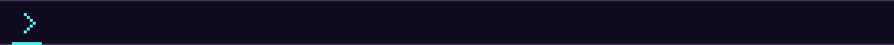
</picture>

## Mission select

**Construcción, diseño y prototipos.** Cada misión tiene su propio estado. Las capturas de Figma muestran interfaces reales de los trabajos compartidos, sin certificar integraciones o despliegues.

### 01 · ASHAKids

<a href="docs/ashakids.md"><picture><source media="(prefers-reduced-motion: reduce)" srcset="assets/cyberpunk/mission-ashakids.png">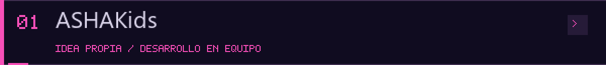</picture></a>

Una iniciativa para acercar actividades lúdicas, seguimiento orientativo y conexión entre familias y profesionales en torno a la comunicación y el aprendizaje infantil.

- **Mi aporte:** idea original desde EduKids y trabajo principalmente en la landing.
- **Proyecto del equipo:** landing, acceso por roles, gestión y actividades interactivas. React, TypeScript, Tailwind CSS, FastAPI y PostgreSQL.
- **Estado:** en desarrollo, con cambios recientes en `dev`. Sin eficacia clínica o educativa validada.

[Repositorio](https://github.com/sromansilva/ashakids-platform/tree/dev) · [Historia y contribución](docs/ashakids.md) · [Cambio de landing](https://github.com/sromansilva/ashakids-platform/commit/5dacd55)

### 02 · LifeXperience

<a href="docs/lifexperience.md"><picture><source media="(prefers-reduced-motion: reduce)" srcset="assets/cyberpunk/mission-lifexperience.png"></picture></a>

**Practica la vida antes de vivirla.** Propuesta educativa basada en simulaciones, historias interactivas y gamificación.

- **Mi participación:** trabajo en el proyecto y su prototipo en Figma; informe pendiente de incorporar.
- **Herramienta comprobable:** Figma Make, por el enlace compartido. La pantalla menciona Supabase; su integración no se ha verificado.
- **Estado:** prototipo; la captura permite observar la bienvenida, no todo el funcionamiento.

[Figma Make](https://www.figma.com/make/PEM0hl8lFPZMcPFT7gFbYG/Next-steps-discussion) · [Caso de estudio](docs/lifexperience.md)

### 03 · MANKA+

<a href="docs/manka.md"><picture><source media="(prefers-reduced-motion: reduce)" srcset="assets/cyberpunk/mission-manka.png"></picture></a>

Propuesta para organizar **abastecimiento de productos, registro de familias y seguimiento de beneficiarios** en ollas comunes de Perú.

- **Mi participación:** trabajo en la propuesta y prototipo de Figma.
- **Herramienta:** Figma. No se atribuye una implementación de backend.
- **Estado:** prototipo; la captura muestra la portada del modo administrador. Los flujos operativos están pendientes de revisión.

[Prototipo en Figma](https://www.figma.com/proto/E2MQIJzdnrB3AHdduSVq4r/Manka-3.0?node-id=22-2&starting-point-node-id=22%3A2) · [Caso de estudio](docs/manka.md)

### 04 · LOOKMI

<a href="docs/lookmi.md"><picture><source media="(prefers-reduced-motion: reduce)" srcset="assets/cyberpunk/mission-lookmi.png">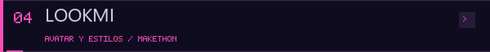</picture></a>

Propuesta para convertir una foto de la mascota en un avatar editable y explorar estilos, accesorios y tipos de corte antes de realizar el look.

- **Mi participación:** trabajo en Figma en el contexto del Makethon realizado en Trujillo que formó parte de esta experiencia.
- **Herramienta comprobable:** Figma Make, por el enlace compartido.
- **Estado:** prototipo. La captura muestra el estudio de edición; no acredita una transformación de fotos o reservas conectadas a servicios reales.

[Figma Make](https://www.figma.com/make/QWhvi0W8B2Do0OfQGDDvJZ/Idea-Development-Support) · [Caso de estudio](docs/lookmi.md)

### 05 · JMP · Inventario y operaciones

<a href="docs/jmp.md"><picture><source media="(prefers-reduced-motion: reduce)" srcset="assets/cyberpunk/mission-jmp.png">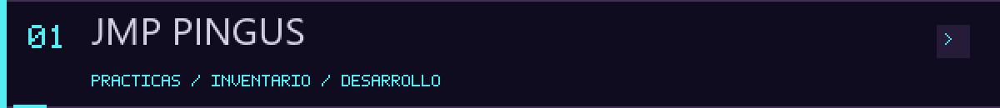</picture></a>

Sistema colaborativo para organizar materiales y operaciones, con solicitudes, devoluciones, documentos PDF y perfiles.

- **Mi aporte:** participación en iteraciones de frontend y backend, flujos, servicios y lógica de datos.
- **Tecnologías del proyecto:** React, TypeScript, Tailwind CSS, Supabase, PostgreSQL y pdf-lib.
- **Estado:** implementación con pruebas en el repositorio. El caso público omite datos y capturas empresariales.

[Repositorio](https://github.com/luisteransaucedo18-coder/JMP-PINGUS-INVENTARIO) · [Mi participación](docs/jmp.md) · [Cambio en solicitudes, PDF y devoluciones](https://github.com/luisteransaucedo18-coder/JMP-PINGUS-INVENTARIO/commit/b316269)

## Team mode · Arcade zone

<a href="docs/gamelab.md"><picture><source media="(prefers-reduced-motion: reduce)" srcset="assets/cyberpunk/mission-gamelab.png">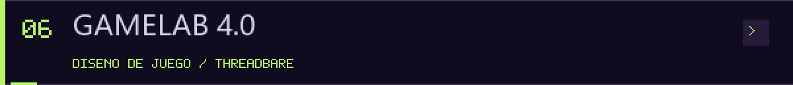</picture></a>

**GAMELAB 4.0 · Grupo 7, equipo 2.** Participé en distintas tareas y diseñé la propuesta de juego del equipo sobre la base de **Threadbare**, un proyecto con Godot. El repositorio es un fork del original de Endless y conserva sus créditos y licencias. No se atribuye un cargo de liderazgo ni la autoría del juego base.

[Organización](https://github.com/Game-Lab-4-0-UTP-Group-7-Team-2) · [Repositorio del equipo](https://github.com/Game-Lab-4-0-UTP-Group-7-Team-2/threadbare) · [Contexto y contribución](docs/gamelab.md)

También colaboro en ASHAKids, JMP y UTPLiteApp. Los casos de estudio distinguen mi trabajo de las funcionalidades y decisiones construidas por el equipo.

## Quest log · De EduKids a ASHAKids

**Experiencia familiar → actividades hechas a mano → EduKids → ASHAKids.**

Durante la pandemia acompañé a mis hermanitos en sus dificultades de lenguaje y comunicación. Esa experiencia motivó una primera exploración digital con EduKids y luego una propuesta más amplia, construida en equipo, con ASHAKids.

[Conocer el origen de la iniciativa](docs/ashakids.md)

<strong>Explorar primeras etapas y otras experiencias</strong>

### EduKids

<a href="docs/edukids.md"><picture><source media="(prefers-reduced-motion: reduce)" srcset="assets/cyberpunk/mission-edukids.png">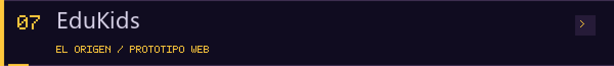</picture></a>

Prototipo estático de actividades infantiles con HTML, CSS y JavaScript. Impulsé y desarrollé esta etapa inicial; incluye adivinanzas propias y contenidos externos integrados. Tiene secciones incompletas.

[Repositorio](https://github.com/amaximilianorodri/EduKids) · [Demo del prototipo](https://amaximilianorodri.github.io/EduKids/) · [Contexto](docs/edukids.md)

### UTPLiteApp

<a href="docs/utpliteapp.md"><picture><source media="(prefers-reduced-motion: reduce)" srcset="assets/cyberpunk/mission-utpliteapp.png">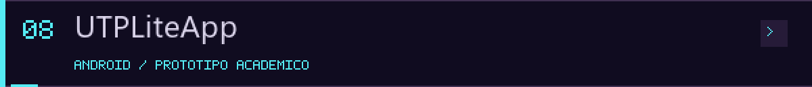</picture></a>

Prototipo académico Android con Kotlin, Java y XML. Mis cambios identificados incluyen calendario, anuncios y login. Utiliza datos estáticos y acceso de demostración.

[Repositorio](https://github.com/sromansilva/UTPLiteApp) · [Mis contribuciones](docs/utpliteapp.md)

### MirrorMind

Prototipo React y TypeScript de interfaces y exploración del análisis emocional. Varias vistas contienen simulaciones; no se atribuye validez clínica. Pendiente de revisión técnica y de seguridad antes de promoverlo como proyecto principal.

[Repositorio](https://github.com/amaximilianorodri/MirrorMind)

### ProyectoHeDe

Sitio institucional estático con HTML, CSS y JavaScript. Su contribución personal detallada está pendiente de precisar.

[Repositorio colaborativo](https://github.com/j3zkills/ProyectoHeDe)

<picture>
  <source media="(prefers-reduced-motion: reduce)" srcset="assets/cyberpunk/circuito.png">
  
</picture>

## Contribution map

**El calendario no cuenta toda la historia.** Mi trabajo en ramas de desarrollo, los commits sin atribución y los prototipos de diseño tienen evidencia adicional que se muestra en los proyectos y la auditoría.

[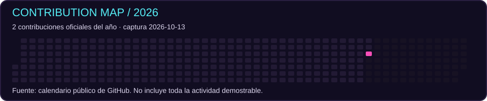](https://github.com/amaximilianorodri?tab=overview&from=2026-01-01&to=2026-12-31)

Ver también el calendario de 2025

[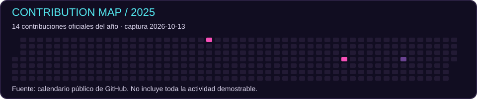](https://github.com/amaximilianorodri?tab=overview&from=2025-01-01&to=2025-12-31)

**Fuentes consultadas el 13 de octubre de 2026.** Son instantáneas, no estadísticas en vivo. Los lenguajes de proyectos colaborativos se describen en sus tarjetas; no se añaden artificialmente a los bytes de mis repositorios.

- **ASHAKids:** [landing vinculada a mi cuenta](https://github.com/sromansilva/ashakids-platform/commit/5dacd55), en una línea de desarrollo distinta de `main`.
- **JMP:** [solicitudes, PDF y devoluciones](https://github.com/luisteransaucedo18-coder/JMP-PINGUS-INVENTARIO/commit/b316269), de autoría confirmada, pendiente de vinculación automática a mi cuenta.
- **UTPLiteApp:** [calendario Android](https://github.com/sromansilva/UTPLiteApp/commit/d2b4dc3), vinculado a mi cuenta y fechado en 2025.

[Actividad oficial actual](https://github.com/amaximilianorodri?tab=overview) · [Auditoría y soluciones](docs/AUDITORIA_CONTRIBUCIONES.md) · [Datos y alcance](assets/actividad/datos.json)

## Skill tree

**Herramientas vinculadas a proyectos, sin niveles de dominio inventados.** Las insignias son etiquetas con logotipos; no son certificaciones.

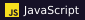 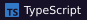 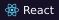  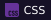

 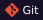  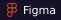

| Área | Evidencia de trabajo |
| --- | --- |
| Web | HTML, CSS y JavaScript en EduKids; React y TypeScript en ASHAKids y JMP |
| Datos | Supabase y SQL de PostgreSQL en cambios de JMP |
| Diseño y prototipado | Figma en LifeXperience, MANKA+ y LOOKMI |
| Móvil | Kotlin, Java y layouts XML en UTPLiteApp |
| Colaboración | Git, GitHub, iteraciones de equipo y documentación |

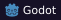 **En el contexto de GAMELAB:** diseño de la propuesta de juego en un proyecto Godot. No se declara dominio de programación en el motor. Python y FastAPI aparecen en el backend del equipo de ASHAKids; no se presentan como implementación exclusivamente mía.

## Next level

Quiero profundizar en arquitectura de software, análisis de procesos, metodologías, gestión de proyectos tecnológicos y automatización. También me interesa seguir explorando transformación digital y soluciones con impacto social.

**Contacto verificado:** [GitHub · @amaximilianorodri](https://github.com/amaximilianorodri).

[Cabecera sin movimiento](assets/cyberpunk/identidad.png) · [Mantenimiento del perfil](docs/MANTENIMIENTO.md) · [Créditos visuales](docs/CREDITOS_VISUALES.md)
