<!-- AMPI.EXE · Diseño anime retrofuturista. El texto de las tarjetas también existe debajo de cada imagen. -->
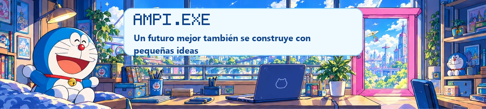

<a href="#sobre-mi">💙 Sobre mí</a> · <a href="#proyectos-destacados">📂 Proyectos</a> · <a href="#laboratorio-de-aventuras">🌟 Aventuras</a> · <a href="#herramientas-y-tecnologias">🧰 Herramientas</a> · <a href="#actividad-de-github">✨ Actividad</a>

## Sobre mí

<table>
<tr>
<td width="29%" valign="top">

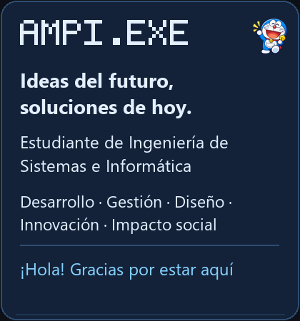

<a href="https://github.com/amaximilianorodri">@amaximilianorodri</a>

  
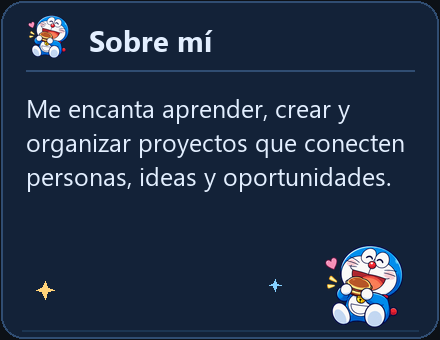

</td>
<td width="71%" valign="top">

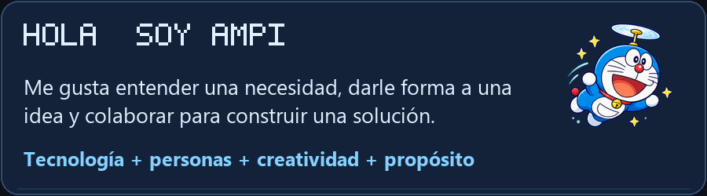

<strong>Estudiante de Ingeniería de Sistemas e Informática.</strong> 
Combino desarrollo, diseño de interfaces, análisis de procesos y organización de proyectos. Impulsé EduKids, que evolucionó hacia ASHAKids desde una experiencia familiar.

  
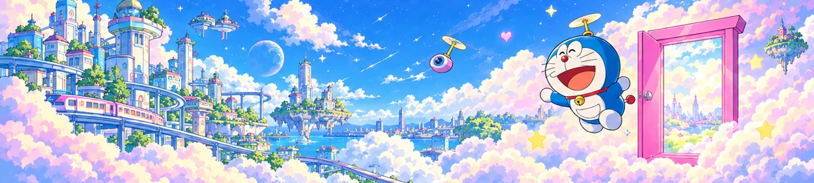

</td>
</tr>
</table>

## Proyectos destacados

Cinco aventuras donde conecto tecnología, creatividad y propósito. Las ilustraciones son decorativas; los casos enlazados conservan el contexto y los créditos.

<table>
<tr>
<td width="50%" valign="top">

<a href="docs/jmp.md">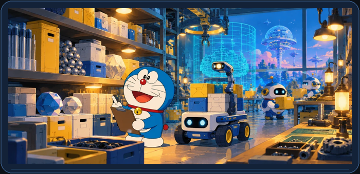</a>

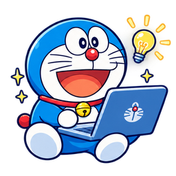 <strong>01 · JMP PINGUS</strong>

Prácticas actuales: participo en el frontend, backend y la lógica de datos del sistema de inventario.

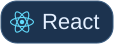     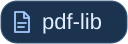  

<strong><a href="https://github.com/luisteransaucedo18-coder/JMP-PINGUS-INVENTARIO">↗ Repositorio</a> · <a href="docs/jmp.md">Mi participación →</a></strong>

</td>
<td width="50%" valign="top">

<a href="docs/ashakids.md">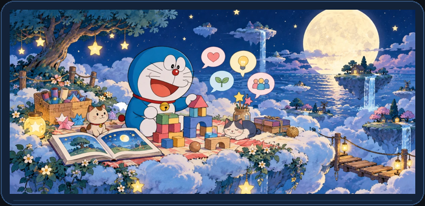</a>

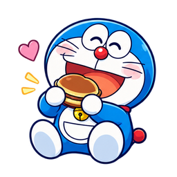 <strong>02 · EduKids → ASHAKids</strong>

Una idea nacida al acompañar a mis hermanitos, que creció en equipo. Mi aporte: idea original y trabajo principalmente en la landing.

<strong>EduKids</strong>    <strong>ASHAKids · interfaz</strong>   <strong>Backend del equipo</strong>    Implementación colaborativa; no se atribuye exclusivamente a mí.

<strong><a href="https://amaximilianorodri.github.io/EduKids/">↗ Demo inicial</a> · <a href="https://github.com/sromansilva/ashakids-platform/tree/dev">ASHAKids →</a> · <a href="docs/ashakids.md">Ver caso →</a></strong>

</td>
</tr>
<tr>
<td width="50%" valign="top">

<a href="docs/lifexperience.md">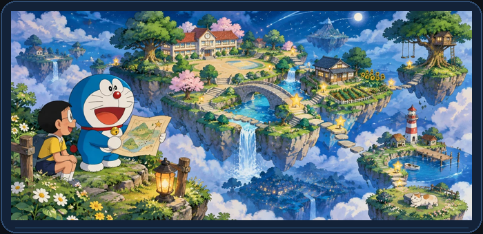</a>

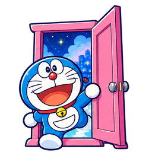 <strong>03 · LifeXperience</strong>

Simulaciones educativas, historias interactivas y gamificación. Mi participación: propuesta y prototipo en Figma Make.

 Prototipo. Integración de backend no verificada.

<strong><a href="https://www.figma.com/make/PEM0hl8lFPZMcPFT7gFbYG/Next-steps-discussion">↗ Ver prototipo</a> · <a href="docs/lifexperience.md">Ver caso →</a></strong>

</td>
<td width="50%" valign="top">

<a href="https://github.com/amaximilianorodri/MirrorMind">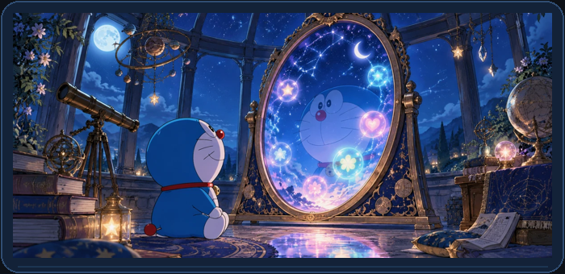</a>

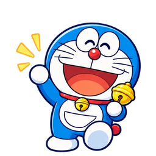 <strong>04 · MirrorMind</strong>

Exploración de interfaces y análisis emocional. Varias vistas son simulaciones; revisión técnica pendiente, sin atribuir validez clínica.

 

<strong><a href="https://github.com/amaximilianorodri/MirrorMind">↗ Explorar repositorio</a></strong>

</td>
</tr>
<tr>
<td width="50%" valign="top">

<a href="docs/gamelab.md">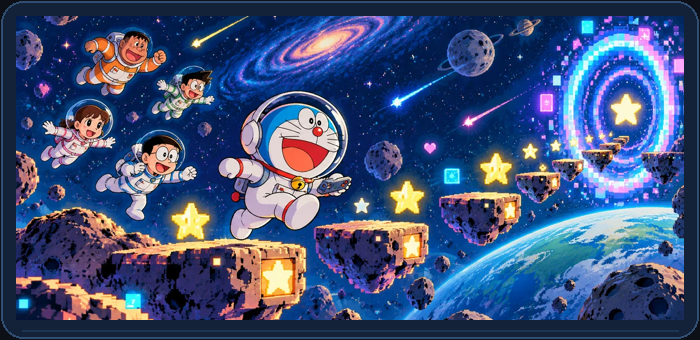</a>

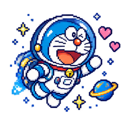 <strong>05 · GAMELAB 4.0</strong>

NeuroEcho, creado con mi equipo. Participé en distintas tareas y en el diseño de la propuesta del juego.

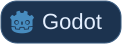 Proyecto sobre Threadbare. Créditos de Endless conservados; mi aporte confirmado es el diseño de la propuesta.

<strong><a href="https://github.com/Game-Lab-4-0-UTP-Group-7-Team-2/threadbare">↗ Repositorio del equipo</a> · <a href="docs/gamelab.md">Ver caso →</a></strong>

</td>
<td width="50%" valign="top">
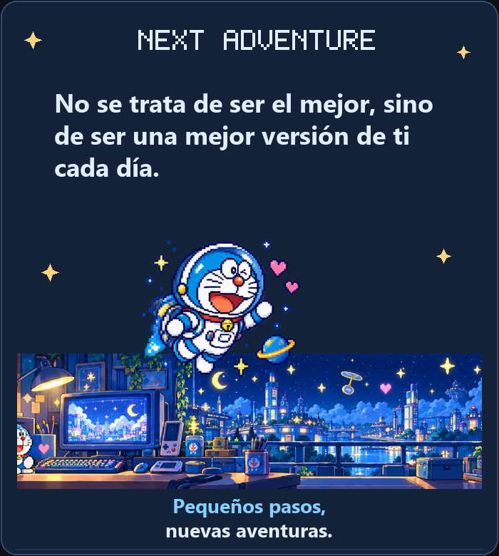
</td>
</tr>
</table>

<strong>Otra experiencia · UTPLiteApp</strong>

**UTPLiteApp · Desarrollo colaborativo Android**

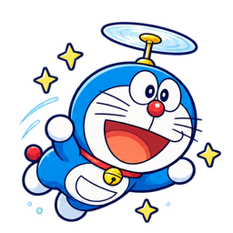

Mis cambios incluyen calendario, anuncios y login. Prototipo con datos estáticos y acceso de demostración.

 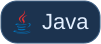   

[Repositorio ↗](https://github.com/sromansilva/UTPLiteApp) · [Mi participación →](docs/utpliteapp.md)

También participé en [ProyectoHeDe](https://github.com/j3zkills/ProyectoHeDe), un sitio institucional estático; el aporte detallado sigue pendiente de precisar.

<picture><source media="(prefers-reduced-motion: reduce)" srcset="assets/anime/separador.png">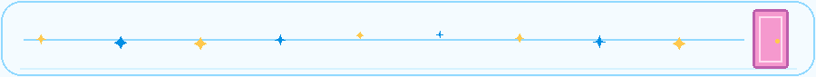</picture>

## Laboratorio de aventuras

Un vuelo de ideas, una puerta a lo nuevo y una aventura por crear. 💙

<picture><source media="(prefers-reduced-motion: reduce)" srcset="assets/anime/animaciones/laboratorio.png">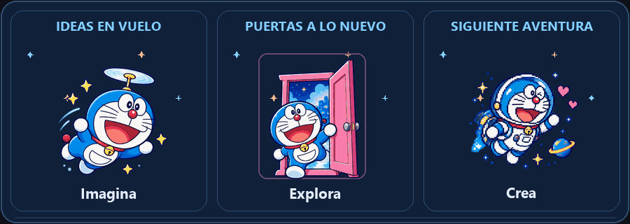</picture>

<a href="assets/anime/animaciones/laboratorio.png">Ver la escena sin movimiento</a>

## Herramientas y tecnologías

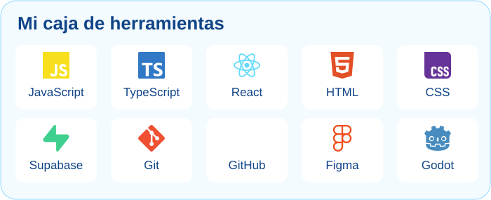

Herramientas que acompañan mis proyectos y mi aprendizaje. Las etiquetas de cada tarjeta indican dónde las utilizo.

<table><tr>
<td width="50%" valign="top">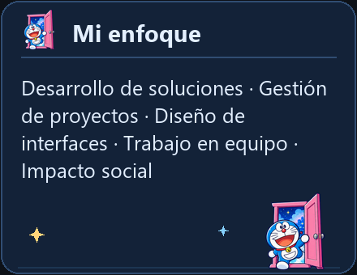</td>
<td width="50%" valign="top">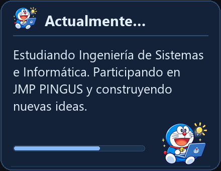</td>
</tr></table>

### Mi próxima aventura

Quiero profundizar en arquitectura, análisis de procesos, metodologías, gestión de proyectos y automatización, y seguir explorando soluciones con impacto social.

<picture><source media="(prefers-reduced-motion: reduce)" srcset="assets/anime/separador.png"></picture>

## Actividad de GitHub

**Actividad y evidencia de colaboración.** GitHub muestra el calendario oficial debajo del perfil. Aquí conservo estadísticas de repositorios y lenguajes, y enlaces a mis aportes; los commits pendientes de atribución se documentan por separado.

**Datos consultados el 13 de octubre de 2026.** Las estadísticas son instantáneas, no datos en vivo.

- **ASHAKids:** [landing vinculada a mi cuenta](https://github.com/sromansilva/ashakids-platform/commit/5dacd55), en una línea de desarrollo distinta de `main`.
- **JMP:** [cambios de autoría confirmada](https://github.com/luisteransaucedo18-coder/JMP-PINGUS-INVENTARIO/commit/b316269), pendientes de vinculación automática a mi cuenta.
- **UTPLiteApp:** [calendario Android](https://github.com/sromansilva/UTPLiteApp/commit/d2b4dc3), vinculado a mi cuenta y fechado en 2025.

[Actividad oficial actual](https://github.com/amaximilianorodri?tab=overview) · [Auditoría y soluciones](docs/AUDITORIA_CONTRIBUCIONES.md) · [Datos y alcance](assets/actividad/datos.json)

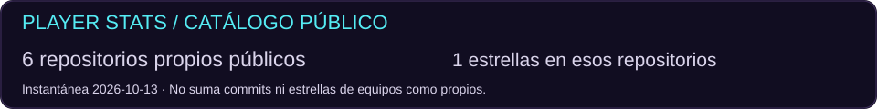

<strong>Ver lenguajes de los repositorios públicos propios</strong>

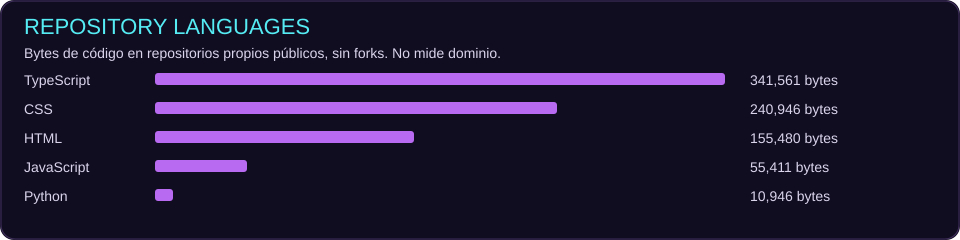

Los lenguajes de proyectos colaborativos se describen en los casos; no se añaden a los bytes de mis repositorios.

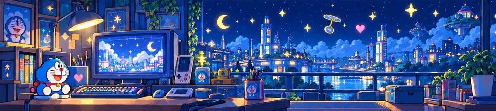

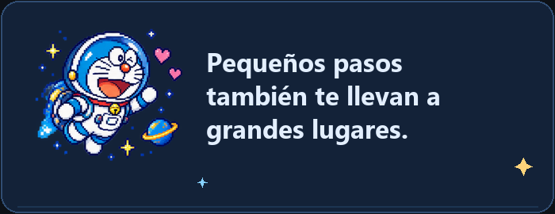

[GitHub · @amaximilianorodri](https://github.com/amaximilianorodri) · [Versión estática del separador](assets/anime/separador.png) · [Mantenimiento](docs/MANTENIMIENTO.md) · [Créditos visuales](docs/CREDITOS_VISUALES.md) · [Escenas y animaciones](docs/ESCENAS_Y_ANIMACIONES.md)
