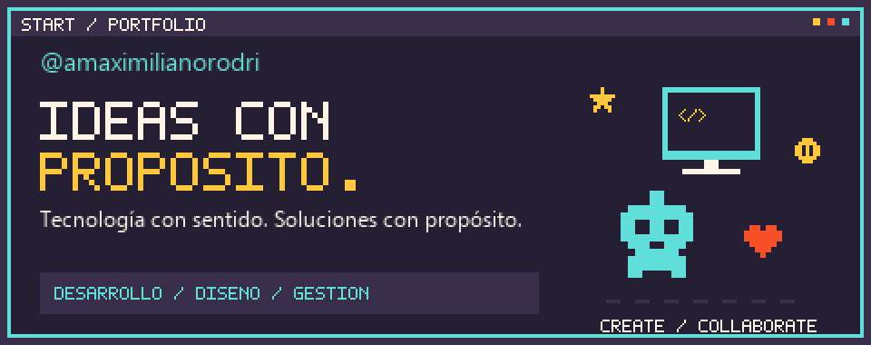
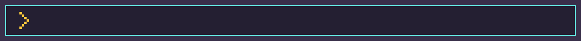
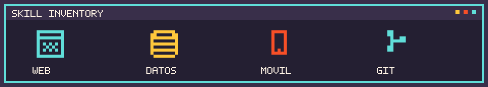
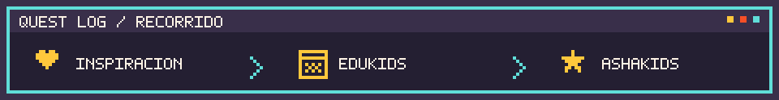
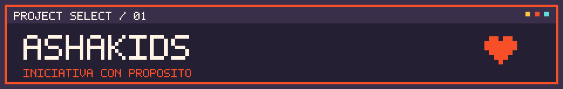
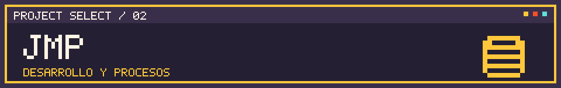
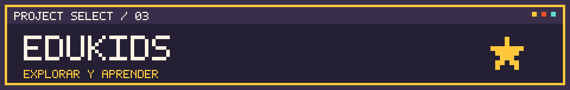
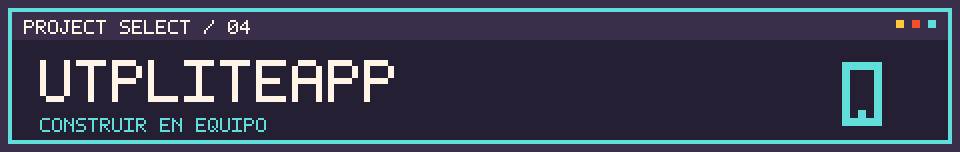
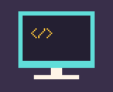

<picture>
  <source media="(prefers-reduced-motion: reduce)" srcset="assets/cabecera.png">
  
</picture>

# Pantalla de inicio

**Bienvenidos a mi recorrido: ideas que conectan, tecnología con propósito.**

[Player profile](#player-profile) · [Skill inventory](#skill-inventory) · [Quest log](#quest-log) · [Project select](#project-select) · [Next level](#next-level)

## Player profile

**Quién soy y cómo construyo.**

Soy estudiante de **Ingeniería de Sistemas e Informática**. Me gusta entender una necesidad, darle forma a una idea y colaborar para convertirla en una solución. Mi recorrido conecta desarrollo de software, diseño de interfaces, análisis de procesos y organización de proyectos.

Impulsé **EduKids**, que evolucionó hacia **ASHAKids** a partir de una experiencia familiar. También participo en proyectos colaborativos de desarrollo web y sistemas de información. Aprendo construyendo, conversando con el equipo y documentando lo que vamos descubriendo.

> **Creatividad para proponer · Desarrollo para construir · Organización para avanzar.**

<picture>
  <source media="(prefers-reduced-motion: reduce)" srcset="assets/intereses.png">
  
</picture>

## Skill inventory

Estas herramientas aparecen en proyectos con contribuciones identificadas. Su presencia no representa un nivel de dominio ni la autoría de toda la arquitectura.

| Área | Experiencia vinculada a proyectos |
| --- | --- |
| Desarrollo web | HTML, CSS y JavaScript en EduKids; React y TypeScript en ASHAKids y JMP |
| Datos y lógica de backend | Supabase y SQL de PostgreSQL en los cambios de JMP |
| Desarrollo móvil | Kotlin, Java y layouts XML en UTPLiteApp |
| Herramientas de colaboración | Git y GitHub |

## Quest log

**Mi recorrido creativo y las experiencias de equipo.**

1. **La inspiración — una necesidad cercana.** Durante la pandemia acompañé a mis hermanitos en sus dificultades de lenguaje y comunicación. Comencé creando actividades lúdicas hechas a mano.
2. **EduKids — la primera exploración digital.** Llevé esa inquietud a un prototipo web con actividades y contenidos infantiles.
3. **ASHAKids — una propuesta que crece en equipo.** La idea evolucionó hacia una plataforma que busca conectar actividades interactivas, familias y profesionales. Mi aporte principal combina el origen de la iniciativa y el trabajo en su landing.

Mi motivación es contribuir a experiencias más accesibles, inclusivas y humanas. Los objetivos del proyecto no se presentan como resultados clínicos o educativos demostrados.

[La historia completa de EduKids → ASHAKids](docs/ashakids.md)

---

### Trabajo en equipo

Mis proyectos combinan iniciativa personal y construcción colectiva. En ASHAKids aporto desde el origen de la idea y la landing; en JMP participo en iteraciones de interfaz y datos; en UTPLiteApp colaboré en pantallas y componentes Android.

Me interesa conectar **comprensión del problema, diseño, desarrollo y documentación**. Los casos de estudio enlazan cambios concretos y distinguen mis aportes de las funcionalidades construidas por el equipo.

[Contribución en ASHAKids](docs/ashakids.md#mi-contribución) · [Contribución en JMP](docs/jmp.md#mi-contribución) · [Contribución en Android](docs/utpliteapp.md#mi-contribución)

**GAMELAB 4.0 · Grupo 7, equipo 2**

Participé en distintas tareas del proyecto y diseñé la propuesta de juego de nuestro equipo sobre la base de **Threadbare**, desarrollado con Godot. Esta experiencia conecta diseño de soluciones y trabajo colaborativo. El repositorio del equipo es un fork del proyecto original de Endless y conserva sus créditos y licencias.

[Repositorio del equipo](https://github.com/Game-Lab-4-0-UTP-Group-7-Team-2/threadbare) · [Contexto y créditos](docs/gamelab.md)

<picture>
  <source media="(prefers-reduced-motion: reduce)" srcset="assets/separador.png">
  
</picture>

## Project select

**Proyectos y aportes reales.** Las etiquetas arcade son una metáfora de presentación; estos proyectos tienen objetivos y estados distintos.

### 01 · ASHAKids

Una iniciativa que busca acompañar la comunicación y el aprendizaje infantil, conectando actividades lúdicas, familias y profesionales. La implementación del equipo incluye una landing, acceso por roles, gestión y actividades interactivas.

- **Mi aporte:** impulsé la idea original desde EduKids y contribuí principalmente al diseño y desarrollo de la landing. La plataforma es un trabajo colaborativo.
- **Tecnologías del proyecto:** React, TypeScript y Tailwind CSS; backend con FastAPI y PostgreSQL.
- **Estado:** en desarrollo, con evolución reciente en `dev`.

[Repositorio y desarrollo](https://github.com/sromansilva/ashakids-platform/tree/dev) · [Origen, evolución y contribución](docs/ashakids.md) · [Cambio de landing](https://github.com/sromansilva/ashakids-platform/commit/5dacd55)

---

### 02 · JMP

Sistema colaborativo para organizar materiales y operaciones. El código incluye solicitudes, devoluciones, generación de documentos PDF y perfiles, con servicios de datos y migraciones SQL.

- **Mi aporte:** participé en distintas iteraciones del frontend y backend, con cambios en esos flujos, servicios y lógica de datos.
- **Tecnologías del proyecto:** React, TypeScript, Tailwind CSS, Supabase, PostgreSQL y pdf-lib.
- **Estado:** implementación con pruebas en el repositorio. Este caso de estudio resume mi trabajo sin exponer datos empresariales.

[Repositorio](https://github.com/luisteransaucedo18-coder/JMP-PINGUS-INVENTARIO) · [Mi participación](docs/jmp.md) · [Cambio en solicitudes, PDF y devoluciones](https://github.com/luisteransaucedo18-coder/JMP-PINGUS-INVENTARIO/commit/b316269)

---

### 03 · EduKids

Prototipo web de actividades infantiles y contenidos lúdicos. Incluye interacciones propias, como adivinanzas, y contenidos externos integrados. Fue una primera exploración de la idea que después evolucionó hacia ASHAKids.

- **Mi aporte:** iniciativa y desarrollo de esta etapa inicial.
- **Tecnologías:** HTML, CSS y JavaScript.
- **Estado:** prototipo estático con secciones incompletas; no representa la plataforma posterior de ASHAKids.

[Repositorio](https://github.com/amaximilianorodri/EduKids) · [Demo del prototipo](https://amaximilianorodri.github.io/EduKids/) · [Contexto y límites](docs/edukids.md)

---

### 04 · UTPLiteApp

Prototipo académico de una aplicación Android para consultar información estudiantil. Explora pantallas de calendario, anuncios y acceso con datos de demostración.

- **Mi aporte:** cambios identificados en calendario, anuncios y login.
- **Tecnologías del proyecto:** Kotlin, Java y layouts XML para Android.
- **Estado:** prototipo; el acceso es de demostración y varias funciones utilizan datos estáticos.

[Repositorio](https://github.com/sromansilva/UTPLiteApp) · [Contribuciones y limitaciones](docs/utpliteapp.md)

---

## Next level

**Lo que quiero seguir explorando.**

Me interesa profundizar en arquitectura de software, análisis de procesos, gestión de proyectos tecnológicos y metodologías de trabajo. También quiero seguir explorando automatización y desarrollo web, conectando esos aprendizajes con los proyectos que construyo.

### Contacto

Puedes conocer mi trabajo y mis contribuciones en [GitHub: @amaximilianorodri](https://github.com/amaximilianorodri).

---

*Construyendo ideas, explorando tecnología y creando soluciones con propósito.*

[Ver la cabecera sin movimiento](assets/cabecera.png)
