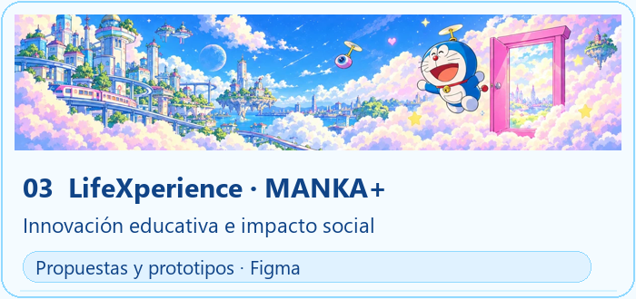
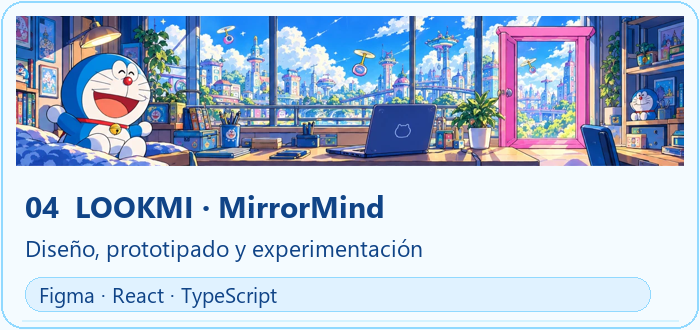
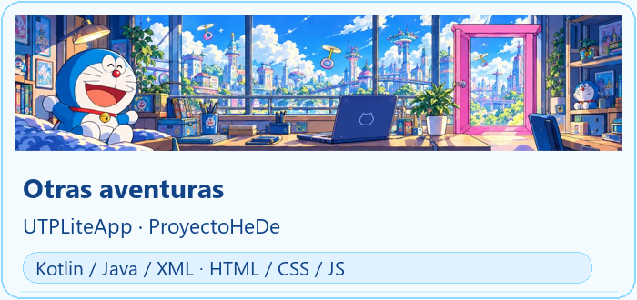
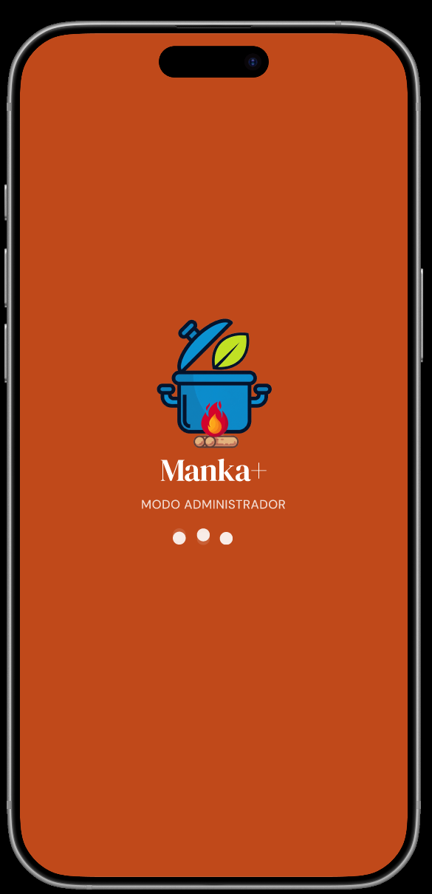
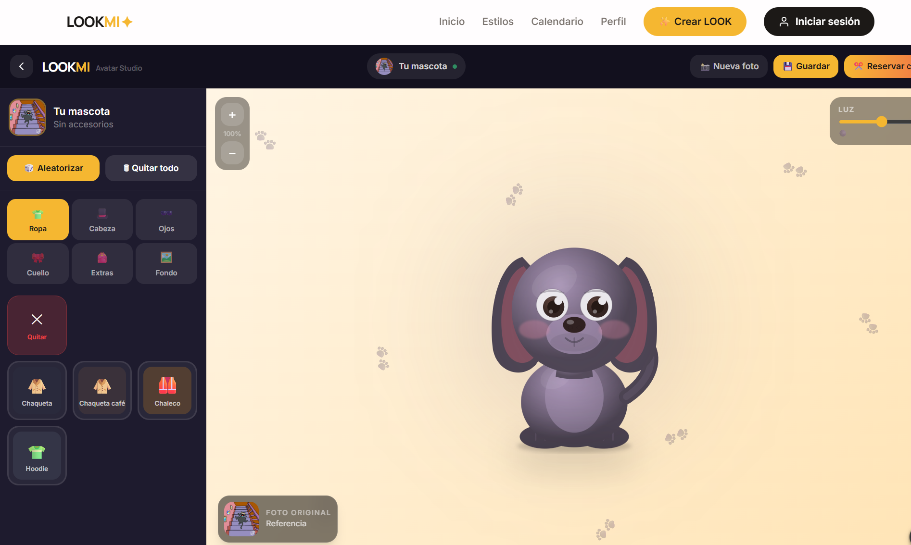

<!-- AMPI.EXE · Diseño anime retrofuturista. El texto de las tarjetas también existe debajo de cada imagen. -->

<a href="#sobre-mi">💙 Sobre mí</a> · <a href="#proyectos-destacados">📂 Proyectos</a> · <a href="#herramientas-y-tecnologias">🧰 Herramientas</a> · <a href="#actividad-de-github">✨ Actividad</a>

## Sobre mí

<table>
<tr>
<td width="29%" valign="top">

<a href="https://github.com/amaximilianorodri">@amaximilianorodri</a>

  

</td>
<td width="71%" valign="top">

<strong>Estudiante de Ingeniería de Sistemas e Informática.</strong> 
Combino desarrollo, diseño de interfaces, análisis de procesos y organización de proyectos. Impulsé EduKids, que evolucionó hacia ASHAKids desde una experiencia familiar.

  

</td>
</tr>
</table>

## Proyectos destacados

Experiencia actual → una idea que creció → innovación e impacto → diseño → videojuegos.

Las ilustraciones de las tarjetas son **arte decorativo**; las capturas reales y la evidencia están en los casos. Cada enlace distingue mi participación del trabajo del equipo.

<table>
<tr>
<td width="50%" valign="top">

<strong>01 · JMP PINGUS</strong> 
Mi experiencia actual como practicante. Participo en frontend, backend, servicios y lógica de datos del inventario.  
React · TypeScript · Tailwind CSS · Supabase · PostgreSQL · pdf-lib  
<a href="https://github.com/luisteransaucedo18-coder/JMP-PINGUS-INVENTARIO">Repositorio ↗</a> · <a href="docs/jmp.md">Mi participación →</a>

</td>
<td width="50%" valign="top">

<strong>02 · EduKids → ASHAKids</strong> 
De acompañar a mis hermanitos con actividades hechas a mano a una propuesta construida en equipo. Idea original y trabajo principalmente en la landing.  
EduKids: HTML · CSS · JavaScript 
ASHAKids: React · TypeScript; backend del equipo: FastAPI · PostgreSQL  
<a href="https://amaximilianorodri.github.io/EduKids/">Demo inicial ↗</a> · <a href="https://github.com/sromansilva/ashakids-platform/tree/dev">ASHAKids ↗</a> · <a href="docs/ashakids.md">Historia →</a>

</td>
</tr>
<tr>
<td width="50%" valign="top">

<strong>03 · LifeXperience · MANKA+</strong> 
Simulaciones educativas y gamificación en LifeXperience; abastecimiento y seguimiento de beneficiarios de ollas comunes en MANKA+.  
Mi participación: propuesta y prototipos en Figma.  
<a href="https://www.figma.com/make/PEM0hl8lFPZMcPFT7gFbYG/Next-steps-discussion">LifeXperience ↗</a> · <a href="https://www.figma.com/proto/E2MQIJzdnrB3AHdduSVq4r/Manka-3.0?node-id=22-2&amp;starting-point-node-id=22%3A2">MANKA+ ↗</a> 
<a href="docs/lifexperience.md">Caso LifeXperience →</a> · <a href="docs/manka.md">Caso MANKA+ →</a>

</td>
<td width="50%" valign="top">

<strong>04 · LOOKMI · MirrorMind</strong> 
Avatares de mascotas y exploración visual en LOOKMI; interfaces y simulaciones de análisis emocional en MirrorMind.  
LOOKMI: prototipo en Figma Make durante el Makethon de Trujillo. 
MirrorMind: React · TypeScript; revisión técnica pendiente.  
<a href="https://www.figma.com/make/QWhvi0W8B2Do0OfQGDDvJZ/Idea-Development-Support">LOOKMI ↗</a> · <a href="https://github.com/amaximilianorodri/MirrorMind">MirrorMind ↗</a> · <a href="docs/lookmi.md">Caso LOOKMI →</a>

</td>
</tr>
<tr>
<td width="50%" valign="top">

<strong>05 · NeuroEcho · GAMELAB 4.0</strong> 
Juego creado con mi equipo, Grupo 7, equipo 2. Participé en distintas tareas y en el diseño de la propuesta.  
Godot · Proyecto sobre Threadbare · Créditos originales de Endless conservados.  
<a href="https://github.com/Game-Lab-4-0-UTP-Group-7-Team-2/threadbare">Repositorio ↗</a> · <a href="docs/gamelab.md">Contexto y contribución →</a>

</td>
<td width="50%" valign="top">

<strong>Otras aventuras en equipo</strong> 
UTPLiteApp: prototipo académico Android; mis cambios incluyen calendario, anuncios y login. 
ProyectoHeDe: sitio institucional estático; aporte detallado pendiente de precisar.  
Kotlin · Java · XML / HTML · CSS · JavaScript  
<a href="https://github.com/sromansilva/UTPLiteApp">UTPLiteApp ↗</a> · <a href="https://github.com/j3zkills/ProyectoHeDe">ProyectoHeDe ↗</a> · <a href="docs/utpliteapp.md">Mis contribuciones →</a>

</td>
</tr>
</table>

### Historias, créditos y evidencia

<strong>01 · JMP PINGUS: alcance y enlaces a mis cambios</strong>

**Mi experiencia actual como practicante:** participo en el desarrollo del sistema de inventario JMP PINGUS y en sus iteraciones de mejora.

El sistema organiza materiales y operaciones mediante solicitudes, devoluciones, PDF y perfiles. **Mi aporte:** cambios en frontend, backend, servicios y lógica de datos. **Estado:** implementación colaborativa con pruebas en el repositorio; el caso público omite información empresarial.

**Tecnologías del proyecto:** React, TypeScript, Tailwind CSS, Supabase, PostgreSQL y pdf-lib.

[Repositorio](https://github.com/luisteransaucedo18-coder/JMP-PINGUS-INVENTARIO) · [Mi participación](docs/jmp.md) · [Solicitudes, PDF y devoluciones](https://github.com/luisteransaucedo18-coder/JMP-PINGUS-INVENTARIO/commit/b316269)

<strong>02 · EduKids → ASHAKids: de dónde nació la idea</strong>

Durante la pandemia acompañé a mis hermanitos en sus dificultades de lenguaje y comunicación con actividades hechas a mano. Esa experiencia dio origen a **EduKids** y creció hacia **ASHAKids**, una propuesta más completa construida en equipo.

**EduKids — el inicio:** impulsé y desarrollé un prototipo web de actividades infantiles con HTML, CSS y JavaScript; conserva secciones incompletas.

**ASHAKids — la evolución:** actividades lúdicas, seguimiento orientativo y conexión entre familias y profesionales. **Mi aporte:** idea original y trabajo principalmente en la landing. **Estado:** desarrollo colaborativo en `dev`, con React y TypeScript en la interfaz y FastAPI y PostgreSQL en el backend del equipo; eficacia educativa pendiente de validación.

Este recorrido describe la evolución de la idea, sin atribuir una migración directa de código entre ambos proyectos.

[EduKids: repositorio](https://github.com/amaximilianorodri/EduKids) · [Demo inicial](https://amaximilianorodri.github.io/EduKids/) · [Caso de EduKids](docs/edukids.md)

[Repositorio y desarrollo](https://github.com/sromansilva/ashakids-platform/tree/dev) · [Historia y contribución](docs/ashakids.md) · [Mi cambio de landing](https://github.com/sromansilva/ashakids-platform/commit/5dacd55)

<strong>03 · LifeXperience y MANKA+: prototipos y estado</strong>

#### LifeXperience

**Practica la vida antes de vivirla:** simulaciones educativas, historias interactivas y gamificación. **Mi participación:** trabajo en la propuesta y el prototipo en Figma. **Estado:** prototipo en Figma Make; informe pendiente de incorporar. La pantalla menciona Supabase, cuya integración no se ha verificado.

[Figma Make](https://www.figma.com/make/PEM0hl8lFPZMcPFT7gFbYG/Next-steps-discussion) · [Caso y captura completa](docs/lifexperience.md)

#### MANKA+

Abastecimiento de productos, registro de familias y seguimiento de beneficiarios de **ollas comunes en Perú**. **Mi participación:** propuesta y prototipo en Figma. **Estado:** prototipo; la captura muestra la portada administrativa, con flujos operativos pendientes de revisión.

[Prototipo en Figma](https://www.figma.com/proto/E2MQIJzdnrB3AHdduSVq4r/Manka-3.0?node-id=22-2&starting-point-node-id=22%3A2) · [Caso y captura completa](docs/manka.md)

<strong>04 · LOOKMI y MirrorMind: prototipos y límites</strong>

#### LOOKMI

Una foto de tu mascota como punto de partida para un avatar editable y la exploración de estilos, accesorios y cortes. **Mi participación:** trabajo en Figma durante el Makethon de Trujillo. **Estado:** prototipo en Figma Make; la captura muestra el editor, sin acreditar transformación de fotos o reservas funcionales.

[Figma Make](https://www.figma.com/make/QWhvi0W8B2Do0OfQGDDvJZ/Idea-Development-Support) · [Caso y captura completa](docs/lookmi.md)

#### MirrorMind

Prototipo de interfaces y exploración del análisis emocional con **React y TypeScript**. **Estado:** varias vistas son simulaciones; revisión técnica y de seguridad pendiente antes de promoverlo como aplicación operativa. No se atribuye validez clínica ni funcionalidades de producción.

[Repositorio de MirrorMind](https://github.com/amaximilianorodri/MirrorMind)

<strong>05 · NeuroEcho, GAMELAB y otras experiencias: créditos del equipo</strong>

**NeuroEcho es el juego creado con mi equipo de GAMELAB 4.0. Mi participación:** distintas tareas y diseño de la propuesta del juego. **Contexto:** proyecto Godot sobre Threadbare; el repositorio es un fork de Endless y conserva sus créditos. La participación de diseño está confirmada por mí; queda pendiente enlazar una entrega específica del equipo.

[Organización](https://github.com/Game-Lab-4-0-UTP-Group-7-Team-2) · [Repositorio del equipo](https://github.com/Game-Lab-4-0-UTP-Group-7-Team-2/threadbare) · [Contexto y contribución](docs/gamelab.md)

<strong>Otras experiencias de desarrollo colaborativo</strong>

- **UTPLiteApp:** prototipo académico Android con Kotlin, Java y XML; mis cambios identificados incluyen calendario, anuncios y login. Utiliza datos estáticos y acceso de demostración. [Repositorio](https://github.com/sromansilva/UTPLiteApp) · [Mis contribuciones](docs/utpliteapp.md).
- **ProyectoHeDe:** sitio institucional estático con HTML, CSS y JavaScript; aporte personal detallado pendiente de precisar. [Repositorio colaborativo](https://github.com/j3zkills/ProyectoHeDe).

También colaboro en ASHAKids y JMP PINGUS; sus casos distinguen mis cambios de las funcionalidades construidas por el equipo.

<strong>Capturas reales de mis prototipos</strong>

<picture><source media="(prefers-reduced-motion: reduce)" srcset="assets/anime/separador.png"></picture>

## Herramientas y tecnologías

**Herramientas utilizadas en proyectos; las insignias no son certificaciones.**

**Web y datos:** EduKids, ASHAKids y JMP. **Diseño:** LifeXperience, MANKA+, LOOKMI y GAMELAB. **Móvil:** UTPLiteApp. En Godot, mi aporte confirmado es diseño de la propuesta del juego.

Relacionar tecnologías con la evidencia de cada proyecto

- **HTML, CSS y JavaScript:** EduKids.
- **React y TypeScript:** trabajo en ASHAKids y JMP.
- **Supabase y SQL de PostgreSQL:** cambios de JMP.
- **Figma:** LifeXperience, MANKA+ y LOOKMI.
- **Kotlin, Java y XML:** cambios de UTPLiteApp.
- **Git y GitHub:** colaboración, iteraciones y documentación.
- **Godot:** entorno de GAMELAB; no se declara dominio de programación en el motor.
- **Python y FastAPI:** backend del equipo de ASHAKids; no se atribuye su implementación exclusivamente a mí.

<table><tr>
<td width="50%" valign="top"></td>
<td width="50%" valign="top"></td>
</tr></table>

### Mi próxima aventura

Quiero profundizar en arquitectura, análisis de procesos, metodologías, gestión de proyectos y automatización, y seguir explorando soluciones con impacto social.

<picture><source media="(prefers-reduced-motion: reduce)" srcset="assets/anime/separador.png"></picture>

## Actividad de GitHub

**Actividad y evidencia de colaboración.** GitHub muestra el calendario oficial debajo del perfil. Aquí conservo estadísticas de repositorios y lenguajes, y enlaces a mis aportes; los commits pendientes de atribución se documentan por separado.

**Datos consultados el 13 de octubre de 2026.** Las estadísticas son instantáneas, no datos en vivo.

- **ASHAKids:** [landing vinculada a mi cuenta](https://github.com/sromansilva/ashakids-platform/commit/5dacd55), en una línea de desarrollo distinta de `main`.
- **JMP:** [cambios de autoría confirmada](https://github.com/luisteransaucedo18-coder/JMP-PINGUS-INVENTARIO/commit/b316269), pendientes de vinculación automática a mi cuenta.
- **UTPLiteApp:** [calendario Android](https://github.com/sromansilva/UTPLiteApp/commit/d2b4dc3), vinculado a mi cuenta y fechado en 2025.

[Actividad oficial actual](https://github.com/amaximilianorodri?tab=overview) · [Auditoría y soluciones](docs/AUDITORIA_CONTRIBUCIONES.md) · [Datos y alcance](assets/actividad/datos.json)

<strong>Ver lenguajes de los repositorios públicos propios</strong>

Los lenguajes de proyectos colaborativos se describen en los casos; no se añaden a los bytes de mis repositorios.

<strong>Pequeños pasos también te llevan a grandes lugares. 💙</strong>

[GitHub · @amaximilianorodri](https://github.com/amaximilianorodri) · [Versión estática del separador](assets/anime/separador.png) · [Mantenimiento](docs/MANTENIMIENTO.md) · [Créditos visuales](docs/CREDITOS_VISUALES.md) · [Informe del rediseño](docs/REDISENO_ANIME.md)
