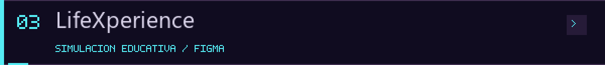
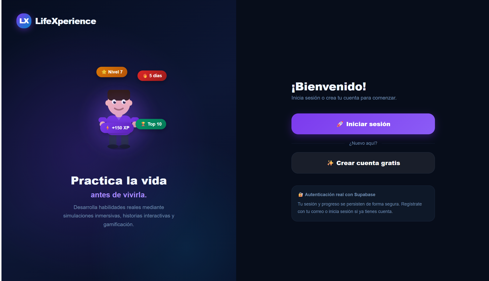

# LifeXperience · Practica la vida antes de vivirla

<picture><source media="(prefers-reduced-motion: reduce)" srcset="../assets/cyberpunk/mission-lifexperience.png"></picture>

## Propuesta

Una propuesta educativa para explorar habilidades mediante simulaciones, historias interactivas y gamificación. La pantalla compartida presenta un avatar y elementos de progreso, junto con opciones de inicio de sesión y creación de cuenta.

## Mi participación y evidencia

Trabajé en este proyecto en Figma y dispongo de un informe de la propuesta. Esta presentación se basa en mi descripción, la captura aportada y el enlace al trabajo en Figma Make. El informe no se ha revisado ni publicado aquí; el reparto detallado de tareas del equipo puede ampliarse después.

La captura permite observar la bienvenida y sus elementos visuales. El nivel, la racha y los puntos que aparecen son parte de esa interfaz; no son estadísticas de mi perfil ni resultados validados de aprendizaje.

## Estado y tecnologías

**Prototipo en Figma Make.** La interfaz menciona autenticación con Supabase. No se ha inspeccionado el backend, probado la persistencia ni validado la seguridad de esa integración; no se presenta como una aplicación certificada para producción.

No se atribuyen a la propuesta beneficios educativos demostrados ni funciones adicionales que no se hayan observado.

[Abrir el trabajo en Figma Make](https://www.figma.com/make/PEM0hl8lFPZMcPFT7gFbYG/Next-steps-discussion) · [Volver al perfil](../README.md)

El enlace fue compartido por la autora. La inspección automatizada no pudo abrir el contenido de Figma; el acceso puede requerir permisos o una sesión. La captura es la evidencia visual disponible, no una validación del flujo completo.
